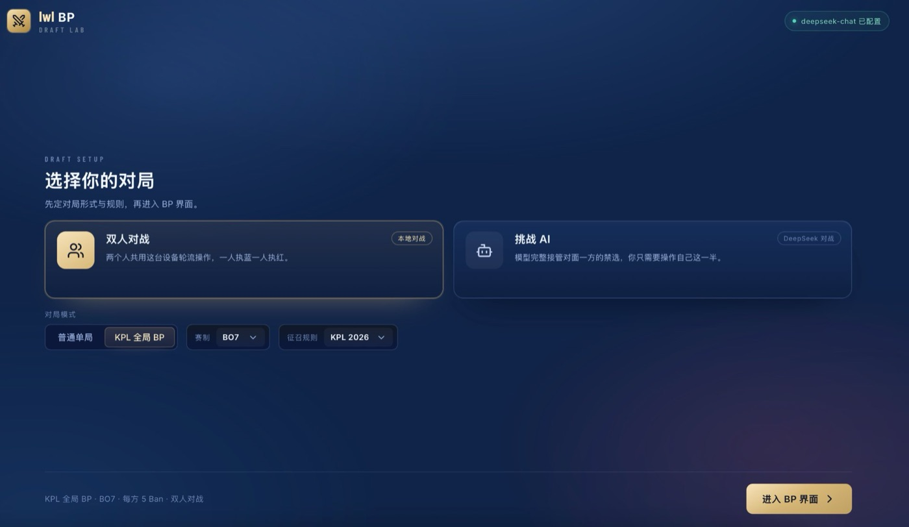
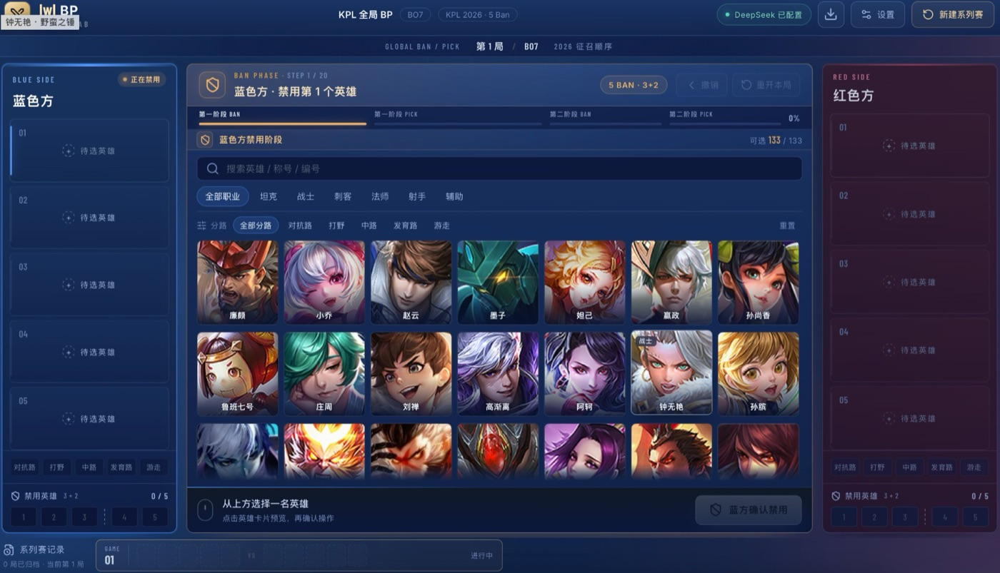
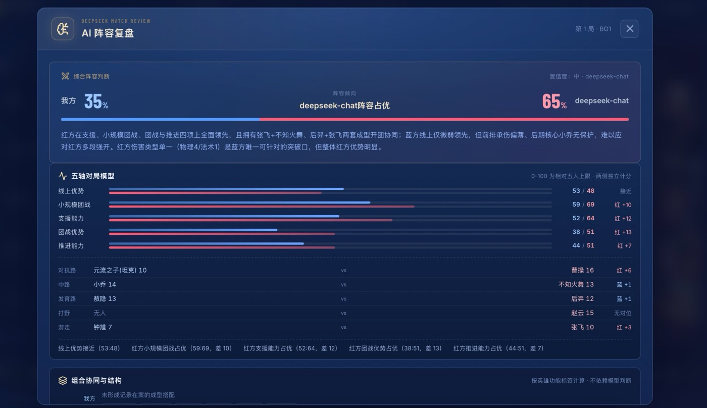
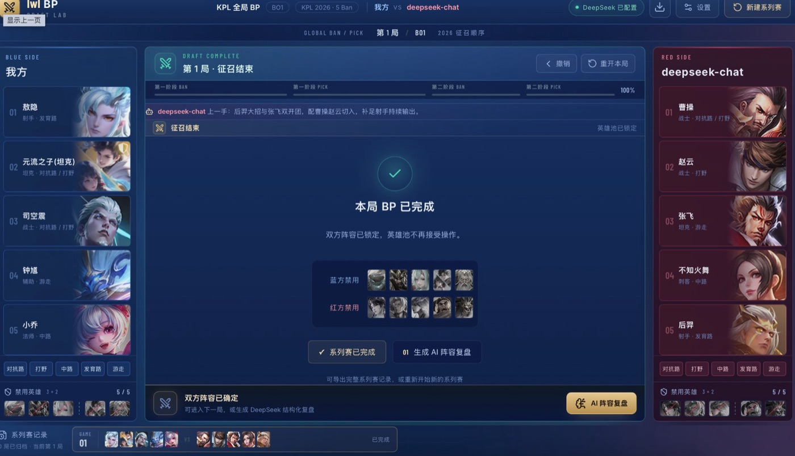

# wzry-bp · 王者荣耀 KPL 征召模拟器

在本地跑的 BP（Ban/Pick）模拟器。完整还原 KPL 全局 BP 的 20 手征召顺序，可以两个人轮流操作，也可以让 AI 接管对面一方；BP 结束后能给出一份带五轴对位模型的阵容复盘。

BP 本身不联网、不需要密钥；只有「AI 阵容复盘」需要配置 DeepSeek API Key。

## 目录

- [它能做什么](#它能做什么)
- [使用流程](#使用流程)
- [AI 对手怎么打](#ai-对手怎么打)
- [环境要求](#环境要求)
- [安装与启动](#安装与启动)
- [复盘面板怎么读](#复盘面板怎么读)
- [数据与算法口径](#数据与算法口径)
- [常见问题](#常见问题)
- [目录结构](#目录结构)
- [开发与测试](#开发与测试)
- [已知限制](#已知限制)

---

## 它能做什么

**征召规则**
- KPL 2026 规则：每方 5 Ban，顺序 3+2；一局共 20 手（6 Ban → 6 Pick → 4 Ban → 4 Pick）
- 经典征召：每方 4 Ban，顺序 2+2
- 普通单局（英雄可重复出现在不同小局）与 KPL 全局 BP（各队英雄池独立，用过的不能再选，Ban 不占池）
- BO1 / BO3 / BO5 / BO7，BO7 第七局自动切到「巅峰对决」：无 Ban、无历史限制、双方秘密选人后同时揭晓

**对战方式**
- 双人对战：一台设备轮流操作，一人执蓝一人执红
- 挑战 AI：AI 接管对面一方的每一手禁选，带 2–3 秒思考态；执蓝执红可选
- AI 未配置密钥时自动降级为本地规则引擎代打，只有复盘会提示去配置

**分路排布**
- BP 完成后是一张 5 行排布表，可拖拽或点选换位，站错路会标「补位」
- 自动排位是五路整体最优解（主路 100 / 副路 55 / 第三路 30 / 未列出 6），不是先到先得

**复盘**
- 服务端先用代码算出组合协同、五轴优势、逐路对位，模型只负责解释这些结论
- 每个事实块带编号（`factKey`），模型引用白名单外的编号会被标「未引用事实」
- 支持导出整轮系列赛记录为 JSON

---

## 使用流程

下面是界面上的四步操作顺序，每步配了实拍图；项目怎么跑起来见后面的「安装与启动」。

### 第 1 步：开场页定对局



页面上的选项从上到下依次是：

1. **对战方式**
   - 「双人对战」：两个人共用这台设备，轮流点自己这一半
   - 「挑战 AI」：AI 接管对面一方。选中后下方会多出「我的位置」，可选**执蓝·先手**或**执红·后手**（先手有首抢权，后手有后置位的针对性调整）
2. **对局模式**
   - 「普通单局」：每局英雄池重置，想选谁都行
   - 「KPL 全局 BP」：双方各自一份英雄池，自己用过的英雄自己不能再选，但对方还能选；Ban 掉的英雄不进任何人的池子
3. **赛制**：BO1 / BO3 / BO5 / BO7。BO7 打满七局时第七局是巅峰对决
4. **征召规则**：KPL 2026（每方 5 Ban，3+2）或经典征召（每方 4 Ban，2+2）

底部那行灰字是当前配置的实时摘要，比如「KPL 全局 BP · BO7 · 每方 5 Ban · 双人对战」。确认无误点右下角**进入 BP 界面**。

> 中途想改设置，点 BP 页右上角「设置」会回到这个页面。已有进度时会弹确认框，确认后当前系列赛会被清空。

### 第 2 步：BP 界面操作



界面分五块，从左到右、从上到下：

**① 顶栏**：左边是规则摘要（模式 · 赛制 · 规则 · 顺位），右边四个按钮——DeepSeek 状态徽标、导出 BP 记录（下载 JSON）、设置（回开场页）、新建系列赛（清空重开）。

**② 阶段进度条**：`第一段 BAN → 第一段 PICK → 第二段 BAN → 第二阶段 PICK`，当前阶段高亮，右上角显示整体进度百分比。

**③ 中央操作区**：这里告诉你现在该谁做什么，例如「蓝方禁用第 1 个英雄」。下面是英雄池：

- 搜索框可按英雄名 / 称号 / 编号搜
- 职业筛选：坦克 / 战士 / 刺客 / 法师 / 射手 / 辅助
- 分路筛选：对抗路 / 打野 / 中路 / 发育路 / 游走
- 不可选的英雄会自动置灰（已被 Ban、已被选、全局 BP 下自己已用）
- **先点英雄卡片预览，再点底部「蓝方确认禁用 / 确认选择」才算落子**，不会误触

右上角的「撤销」回退上一手，「重开本局」清空当前小局（历史小局保留）。

**④ 两侧阵容栏**：每侧 5 个 Pick 槽 + 底部禁用格。每个已选英雄会显示「职业 · 分路」，下方五枚分路标签会高亮已被覆盖的路，用来快速看阵容缺哪一路。禁用区标题旁的 `3+2` 表示 Ban 位分段，`0/5` 是已用量。

**⑤ 系列赛记录**：页面最底部，按小局列出每局的阵容与状态（进行中 / 已完成）。

KPL 2026 规则下一局的完整顺序（20 手）：

| 阶段 | 手数 | 谁在动 |
|---|---|---|
| 第一段 BAN | 6 | 蓝红交替，各 3 手 |
| 第一段 PICK | 6 | 蓝 1、红 2、蓝 2、红 1（首抢 → 连选 → 反手连选） |
| 第二段 BAN | 4 | 红蓝交替，各 2 手 |
| 第二阶段 PICK | 4 | 红 1、蓝 2、红 1 |

### 第 3 步：BP 完成 → 分路排布



双方各 5 手选完后，中央会显示「本局 BP 已完成」，两侧阵容锁定，下方列出双方禁用回顾：

- **AI 阵容复盘**：进入复盘弹窗（下一步讲）
- **进入第 N 局**：赛制没打满时出现；打满则显示「系列赛已完成」。BO3 以下的输赢不在这里判定，只是记录每局阵容
- **揭晓阵容**：只有 BO7 第七局、双方秘密选完但还没揭晓时出现，点了之后双方阵容才同时亮出来
- 底部提示「可导出完整系列赛记录，或重新开始新的系列赛」——记录只存在当前页面会话里，**刷新页面就没了，需要留存请点右上角下载图标导出 JSON**

BP 完成后中央区会换成**分路排布表**：


- 五行分别是：对抗路 / 打野 / 中路 / 发育路 / 游走
- 换位有两种方式：把英雄卡**拖到**目标格，或**点一下**英雄再点目标格
- 拖到已占位的格子，两人互换；其余位置不动
- 从左侧阵容栏直接把英雄拖进来也行
- 每个英雄带 **主路 / 副路 / 补位** 标签，摆错路会标「补位」，一眼看得出来
- 每侧有「自动」按钮，一键回到按主路算出的排布
- 巅峰对决未揭晓时，对手那列显示「阵容待揭晓」，不会提前泄露

你的手动排布会随复盘请求一起发送，逐路对位以你摆的为准，不是程序重新猜的。

### 第 4 步：生成 AI 阵容复盘



点「AI 阵容复盘」，弹窗会先显示加载态（十几秒到几十秒，取决于模型响应），然后渲染完整报告。底部的「重新分析」可以用同一份阵容再生成一次。

复盘需要同时满足：双方各 5 个英雄已选完、服务端配好了 key、服务端正在运行。任意一条不满足会直接给出提示文案，说明缺什么。

---

## AI 对手怎么打

点「挑战 AI」后，对手那一方每一手都由服务端自动完成，你不用等它、也不能替它选。它的选择不是固定套路：

**每场系列赛换一种思路。** 思路决定「什么样的英雄算好」，一共六种，按系列赛序号轮转，连开两场一定不一样；同一场 BO3/BO5 里每换一局也会继续轮转：

| 思路 | 想要什么 | 禁人时优先拆什么 |
|---|---|---|
| 版本答案 | 抢版本强度最高的 | 对手最可能一抢的强势点 |
| 强开团 | 先手开团、控制链连续 | 对手的保护与续航 |
| 保核心 | 保护链 + 后期大核 | 能越过前排切核心的英雄 |
| 运营推进 | 清线快、能压塔 | 对手清线快、能拖后期的 |
| 抓单切入 | 绕后机动 + 单点爆发 | 对手的高机动与保人 |
| 针对性 | 压制对手已选英雄 | 对手成型所需的那块拼图 |

思路会显示在 AI 决策理由那一行的右侧（`本局思路 · 强开团`），悬停看一句话说明；AI 思考时，遮罩上也会写「正在按『强开团』思考」。

**它会看你的阵容调整，不是照榜单念。** 你场上两个硬开团，它就抬抗控类英雄的权重；你有两个站不住的后期核心，它就优先禁切入与爆发；你前排厚，它就偏向持续输出。反过来，它禁人也看自己的软肋——自己缺开团又怕先手，就把强开英雄禁掉。

**它是先凑出完整阵容再落子，不是逐手比单个英雄谁强。** 每一手都会用束搜索把剩下的人补齐成多套五路齐全的五人阵容，再按前排厚度、开团与接火、后排保护、伤害类型、控制链、强势期、组合协同和对位关系给整套阵容打分；当前候选进得了多强的阵容，它的价值就有多高。禁人同理——它比较的是「对手能拿到你」和「你被禁掉」两种情况下的最佳阵容差多少分，所以理由会写成「禁后对手最佳整队评分下降 23.4」，并列出被阻止的那套五人阵容。英雄池不足 5 人、凑不出完整阵容时，自动退回单英雄评分，不会卡住。

**它会记住这一场系列赛。** 前几局用过的英雄会被压低权重（全局 BP 下本来就已经不可选），同一场 BO 里不会把一模一样的五个人再摆一遍。

**没有配 key 也能打。** 未配置 DeepSeek 时，AI 由规则引擎直接落子，照样有思路轮转、整队规划和针对性判断，只是理由文案不是模型写的。

打分逻辑在 `server/ai-draft.mjs`（单英雄评估、临场针对、同分打散、候选生成），整队评分与推演在 `server/team-planner.mjs`，思路定义在 `shared/styles.mjs`（权重表），改 JSON 或改权重都会直接生效，重启服务即可。

---

## 环境要求

| 项目 | 要求 | 说明 |
|---|---|---|
| Node.js | **≥ 22.9** | 启动脚本用到 `--env-file-if-exists`，Node 20 会报 `bad option` |
| 浏览器 | Chrome / Edge / Safari 近两年版本 | 界面是深色大屏布局，建议 ≥ 1280px 宽 |
| DeepSeek Key | 仅复盘需要 | 不配也能完整跑 BP 和人机对战 |

```bash
node -v   # 应该是 v22.9.0 或更高
```

---

## 安装与启动

### 1. 安装依赖

```bash
git clone https://github.com/lwl-ManchesterCity/wzry-bp.git
cd wzry-bp
npm install
```

### 2. 配置 DeepSeek 密钥（想用复盘才需要）

**第 1 步：拿到 key**

打开 [platform.deepseek.com](https://platform.deepseek.com) → 登录 → 左侧「API keys」→ 创建，复制 `sk-` 开头的那串。key 只显示一次，创建完立刻存好。

**第 2 步：写进 `.env`**

项目根目录（和 `package.json` 同级）有一个 `.env.example`，复制成 `.env`：

```bash
cp .env.example .env
```

然后编辑 `.env`，至少填第一行：

```ini
DEEPSEEK_API_KEY=sk-你的真实密钥
DEEPSEEK_BASE_URL=https://api.deepseek.com
DEEPSEEK_MODEL=deepseek-chat
PORT=3001
```

| 变量 | 必填 | 说明 |
|---|---|---|
| `DEEPSEEK_API_KEY` | 复盘必填 | 留空或写成 `sk-xxxxxx` 占位会被当成「未配置」 |
| `DEEPSEEK_BASE_URL` | 否 | 走官方直连不用改；用中转服务时填中转地址 |
| `DEEPSEEK_MODEL` | 否 | 默认 `deepseek-chat`，账号支持别的模型时可替换 |
| `PORT` | 否 | 服务端端口，默认 3001。**改了要同步改 `vite.config.ts` 的 proxy**，否则前端调不到接口 |

**第 3 步：几个必须知道的点**

- `.env` 已经在 `.gitignore` 里，不会被提交，也不会打进前端包；key 只在 Node 服务端读取
- **改完 `.env` 必须重启服务**。`npm run dev` 的 `--watch` 只监听服务端代码变更，不会重读 env 文件
- 前端页面拿不到 key，只拿得到「有没有配好」这个布尔值，所以别人打开你的页面也偷不到

**第 4 步：确认配好了**

启动后有两种验证方式，任选其一：

```bash
# 方式一：命令行
curl http://127.0.0.1:3001/api/health
# 期望返回 {"configured":true,"model":"deepseek-chat"}
```

方式二：看界面左上角徽标，显示「deepseek-chat 已配置」就是生效了；显示「待配置」说明 `.env` 没读到或 key 是占位值。

### 3. 启动

```bash
npm run dev
```

会同时起两个进程：

- 前端 Vite：http://127.0.0.1:5173 （被占用时自动顺延到 5174、5175…，看终端输出）
- 服务端 Express：http://127.0.0.1:3001 （`/api/health`、`/api/ai-draft`、`/api/review`）

前端所有 `/api/*` 请求由 Vite 代理到 3001，所以**不要只开前端不开服务端**，否则人机对战和复盘都会失败。

生产构建：

```bash
npm run build   # 类型检查 + 打包到 dist/
npm start       # 只起服务端，需要自己用 nginx 之类托管 dist/
```

---

## 复盘面板怎么读

报告从上到下是这几块（对照上图 ④），**前四块是代码算出来的硬结论，后三块是模型基于这些结论的解释**。

**① 综合阵容判断**
左上蓝方胜率、右上红方胜率、中间写谁的阵容占优，右上角标模型与置信度。这是「阵容层面」的相对倾向，不是对局预测——选手水平、临场发挥都不在里面。

**② 五轴对局模型**
五行：线上优势 / 小规模团战 / 支援能力 / 团战优势 / 推进能力。

- 数值是 **0–100，含义是「相对五人上限的完成度」，两侧独立计分**，不是两边加起来等于 100
- 右侧差值小于 6 统一显示「接近」，避免把噪声当优势
- 下面的逐路对位表：每行一路，显示双方英雄与分值。三种特殊情况——`无人` 表示这路没人、`无对位` 表示对面这路空缺、`补位` 表示该英雄不是这条路的常规选择
- 最底部一行是自动生成的口径说明，例如「线上优势接近（53-48）· 红方小规模团战占优（59-69，差 10）」

**③ 组合协同与结构**
按英雄功能标签计算，不经过模型。

- **强协同 / 条件协同**：命中组合库的搭配，标「机制推导」的是按技能机制模板推出来、组合库里没写死的
- **被拆**：本来能成立的组合，因为对面 Ban 掉了其中一人而废掉
- 结构指标：前排（满分 15）、硬开团人数、保人人数、消耗分、控制分、机动力
- 下面是按严重程度排序的结构问题（缺前排、缺开团、伤害类型单一等）

**④ 分析依据**
显示的赛季、区间与数据截至时间，以及每个英雄的出场场次与胜率。虚线框表示样本不足 15 场，参考价值有限。旁边的提示写得很清楚：胜率同时受队伍实力影响，不等同于英雄强度。

**⑤ 双方阵容分析**（模型）
每侧列出阵容优势、潜在短板、关键节奏、推荐打法。

**⑥ 关键对位与联动**（模型）
模型挑出的重点对位。标题后面如果出现「未引用事实」标记，说明这条结论没能对应到前面任何一个事实块，属于模型自由发挥，可信度要打折。

**⑦ 本场获胜条件**（模型）
编号列出蓝方要赢需要做到什么。

面板底部有免责说明：AI 结论仅供阵容讨论，实际对局还受选手状态、版本与执行影响。

---

## 数据与算法口径

| 文件 | 内容 | 规模 |
|---|---|---|
| `src/data/heroes.json` | 英雄基础信息（名称、称号、职业、分路、头像） | 133 位 |
| `src/data/hero-synergy.json` | 10 维功能标签 + 显式组合库 | 133 位 / 40 条组合 |
| `src/data/hero-macro.json` | 宏观七维：持续输出、范围伤害、清线、推进、绕后单带、对线压制、抗控换控 | 133 位 × 0–3 整数 |
| `src/data/kpl-stats.json` | KPL 赛季数据快照（出场、胜率） | 快照 |

算法分工：

- `shared/lanes.mjs`：五路落位求解（主路 100 / 副路 55 / 第三路 30 / 未列出 6，职业偏好 +8 只在同分时裁决），五个人最多 120 种排法直接求全局最优；前后端共用同一套算法，保证界面和复盘看到的是同一个排布
- `server/synergy.mjs`：显式组合配对 + 机制模板推导（保护链、消耗封锁、开团接火、切入收割、对线换血、推进压制），并检测被 Ban 拆断的组合
- `server/matchup.mjs`：五轴绝对分与逐路对位，只按主路落位，副路不自动补位
- `server/ai-draft.mjs`：AI 禁选决策，Ban 与 Pick 复用同一套评估；同分路占用时组合分按 0.25 折算，避免出现「连禁两个射手」
- `server/index.mjs`：把上面这些算成带 `factKey` 的事实块塞进 prompt，并在返回后校验模型引用

一句话：**结构、对位、组合这些结论由代码先算，模型只负责把这些结论讲成一段能读的话。**

---

## 常见问题

**Q：左上角一直显示「待配置」**
三种可能：`.env` 不在项目根目录（要和 `package.json` 同级）；改完没有重启服务；key 还是 `sk-xxxxxx` 这类占位值（会被主动判为未配置）。用 `curl http://127.0.0.1:3001/api/health` 看返回值最直接。

**Q：复盘报 401 / invalid api key**
key 复制时带了空格或换行，或者 key 已被删除/额度用尽。重新创建一把，粘进 `.env` 时别带引号和空格，然后重启。

**Q：复盘一直转圈然后报错**
先看终端里服务端的报错。常见原因是网络到 `api.deepseek.com` 不通（换 `DEEPSEEK_BASE_URL` 中转），或者模型名写错（`DEEPSEEK_MODEL` 要和账号实际可用的模型一致）。

**Q：AI 选人等了很久，或者直接落了个莫名其妙的英雄**
单步决策有 30 秒超时，超时会用兜底方案落子并提示「AI 决策超时」。如果频繁出现，检查网络或看服务端日志。

**Q：3001 端口被占用**
改 `.env` 里的 `PORT`，**同时**改 `vite.config.ts` 里 proxy 的目标地址（两处必须一致），然后重启。

**Q：改了 `hero-synergy.json` 但界面没变化**
前端的热更新能刷新界面，但服务端的组合检测在启动时读文件，**要重启服务端**才生效。

**Q：刷新页面，之前的系列赛没了**
BP 记录是页面内存态，没有持久化。要留存请点右上角下载图标导出 JSON（文件名 `kpl-draft-<时间戳>.json`）。

**Q：BO7 第七局为什么没有 Ban 位**
巅峰对决规则就是无 Ban。双方秘密选完人再揭晓，不支持重复英雄以外的历史限制。

**Q：为什么某一路显示「无人」**
你的阵容里没有人主路是这条路，且你没有手动把人拖过去。手动排布后就会显示对应的对位。

---

## 目录结构

```
src/
  engine/        BP 顺位状态机（draft.ts）、分路求解（lineup.ts）
  components/    SetupScreen 开场页 / TeamPanel 阵容栏 / HeroPool 英雄池
                 LineupBoard 分路排布 / ReviewModal 复盘弹窗 / AppSelect 下拉
  composables/   useDraft：一局完整状态、AI 回合接管、导出
  data/          英雄、组合库、宏观七维、赛季快照
shared/          lanes.mjs 前后端共用的落位算法、styles.mjs AI 思路权重表
server/          index.mjs 入口与 prompt 组装、synergy 组合检测
                 matchup 五轴对位、ai-draft AI 决策、team-planner 整队评分与推演
tests/           Vitest 单测（顺位、组合、对位、分路、整队规划、AI 差异性）
scripts/         数据抓取与端到端冒烟脚本
docs/            NBA 版交接文档、界面截图
```

---

## 开发与测试

| 命令 | 说明 |
|---|---|
| `npm run dev` | 前端 + 服务端一起起 |
| `npm run build` | `vue-tsc` 类型检查 + Vite 打包 |
| `npm test` | Vitest 单测，57 项（含整队规划与 Ban 损失） |
| `npm run test:ui` | 端到端：跑完 20 手 BP 并触发真实复盘（需要 key） |
| `npm run test:ai` | 人机对战闭环 |
| `npm run test:lineup` | 分路面板：点击换位、拖拽换位、自动复位 |
| `npm run test:ai-variety` | AI 差异性：同一套玩家阵容下换成 8 个种子，禁用与阵容是否分散，且每套五路齐全 |
| `npm run test:ai-style` | AI 差异性端到端：同页面连开两场，思路轮转与禁选是否变化 |
| `npm run heroes:fetch` | 重新抓取英雄与头像 |
| `npm run stats:fetch` | 更新 KPL 赛季数据快照 |

冒烟脚本用的是本机 Chrome，路径写死在 `scripts/*.mjs` 里（`/Applications/Google Chrome.app/...`），换机器要改，或改成 `channel: 'chrome'`。

---

## 已知限制

- 组合库与宏观七维是**按英雄机制人工标注**，不是官方数据，理解不同改 JSON 即可
- 赛季数据是快照，不会自动更新，需要手动跑 `npm run stats:fetch`
- 五轴分值是相对量，适合横向比阵容，不适合跨对局纵向比较
- 分路对位只按主路落位，副路不自动补位；跨路换位需要你手动拖
- AI 的思路是**程序化权重**（版本强度 / 组合协同 / 临场针对），不是真的战术板推演；同一思路下仍会在同档候选里换人，但不会出现职业队那种针对性设套
- 记录不持久化，关掉页面就没了（只有 AI 思路的轮转序号记在 localStorage）
- 移动端未适配，界面按桌面大屏设计

---

## 免责声明

本项目仅用于学习与技术演示。英雄名称、头像及相关数据版权归腾讯《王者荣耀》所有；开发过程中未使用任何商业素材分发。AI 复盘结论由大模型生成，仅供参考。
