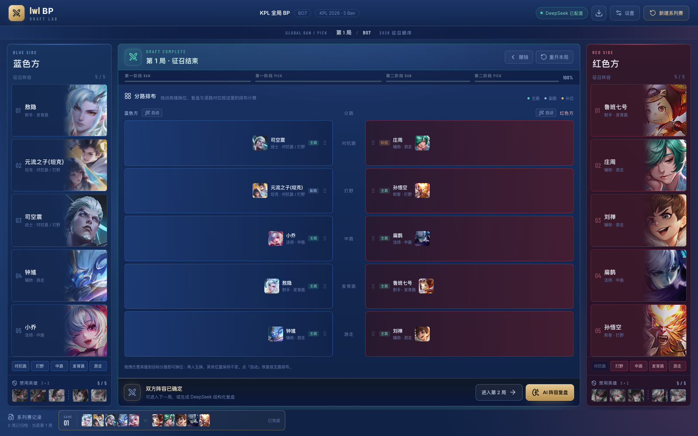

# wzry-bp · 王者荣耀 KPL 征召模拟器

一个本地跑的 BP（Ban/Pick）模拟器：完整还原 KPL 全局 BP 流程，可选双人对战或让 AI 接管一方，BP 结束后由 DeepSeek 结合真实赛季数据给出五轴复盘。



## 功能

**BP 流程**
- 经典 BP 与 KPL 全局 BP（各队英雄池独立，Ban 不入池）
- BO1 / BO3 / BO5 / BO7，Ban 位按官方 3+2 顺序
- BO7 第七局巅峰对决：无 Ban、无历史限制、可重复，双方秘密选人后揭晓
- 133 位英雄真实头像，按职业 / 分路 / 关键词筛选

**人机对战**
- 开场页选择执蓝或执红，AI 实时接管对方，每一步都有 2–3 秒思考态
- AI 决策会考虑阵容结构、组合协同、分路槽位互斥，不会出现「连禁两个射手」这类自伤

**分路排布**
- BP 完成后进入 5 行排布表，可拖拽或点选换位，站错路会标「补位」
- 自动排位是五路整体最优化（主路 100 / 副路 55 / 第三路 30），不是先到先得
- 手动排布会随复盘请求传给服务端，逐路对位以此为准

**复盘**
- 服务端先算组合协同、五轴优势、逐路对位，模型只负责解释，结论不靠模型编
- 每个事实块带 `factKey`，模型引用不在白名单里的编号会被标 `unverified`
- 五轴：线上优势 / 小规模团战 / 支援 / 团战 / 推进

## 技术栈

| 层 | 选型 |
|---|---|
| 前端 | Vue 3 + TypeScript + Vite，lucide-vue-next 图标 |
| 服务端 | Express（`server/index.mjs`），代理 DeepSeek，密钥只在服务端 |
| 数据 | 本地 JSON（英雄、组合库、宏观七维、KPL 赛季快照） |
| 测试 | Vitest 单测 + playwright-core 端到端冒烟 |

## 快速开始

```bash
npm install
cp .env.example .env      # 填入 DEEPSEEK_API_KEY
npm run dev               # 前端 5173 + 服务端 3001
```

只跑前端也能完成 BP，只有复盘需要 key。

## 脚本

| 命令 | 说明 |
|---|---|
| `npm run dev` | 前端 + 服务端同时起 |
| `npm run build` | 类型检查 + 打包 |
| `npm test` | Vitest 单测（BP 顺位、组合检测、对位模型、分路求解） |
| `npm run test:ui` | 端到端冒烟：跑完整 20 手 BP 并触发真实复盘 |
| `npm run test:ai` | 人机对战闭环 |
| `npm run test:lineup` | 分路面板点击换位、拖拽换位、自动复位 |
| `npm run heroes:fetch` | 重新抓取英雄与头像 |
| `npm run stats:fetch` | 更新 KPL 赛季数据快照 |

## 目录结构

```
src/
  engine/        BP 顺位状态机、分路求解
  components/    SetupScreen 开场页 / TeamPanel 阵容栏 / HeroPool 英雄池
                 LineupBoard 分路排布 / ReviewModal 复盘弹窗
  composables/   useDraft：一局的完整状态与 AI 回合接管
  data/          英雄、组合库、宏观七维、赛季数据
shared/lanes.mjs 前后端共用的落位算法
server/          Express 入口、组合检测、对位模型、AI 决策
docs/            NBA 版复用同一顺位引擎的交接文档
```

## 数据说明

- 组合库（40 条显式组合）与宏观七维标签是按英雄机制人工标注，不是官方数据，改 JSON 即生效
- 赛季数据是快照，用 `npm run stats:fetch` 更新
- 复盘结论依赖模型的解释能力，但结构、对位、组合这些硬结论都由代码先算出，模型只能引用

## License

未指定。图片与英雄数据版权归腾讯《王者荣耀》所有，本项目仅作学习与技术演示用途。
