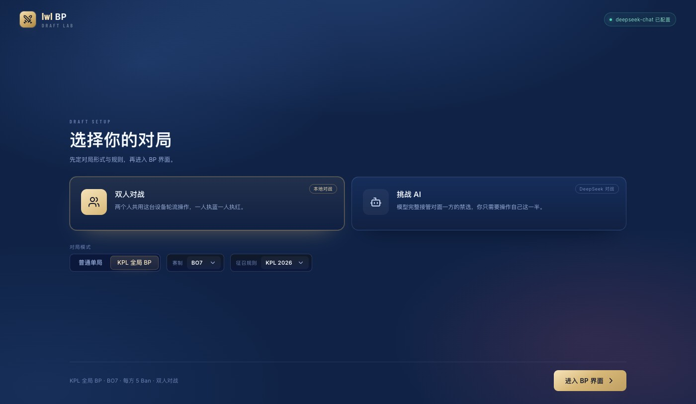
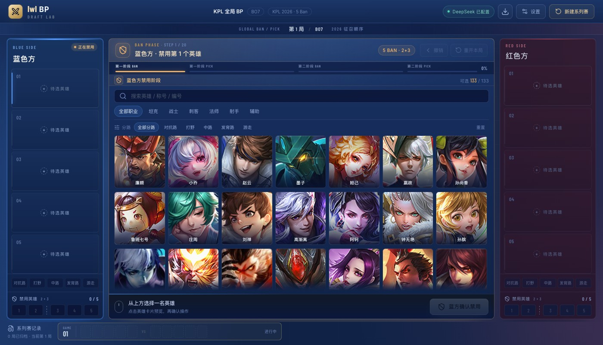
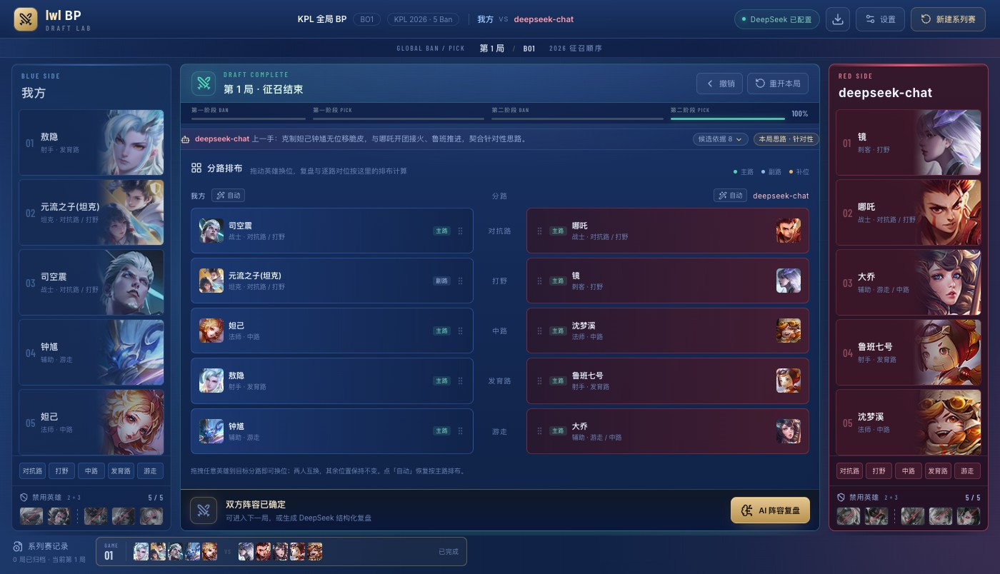
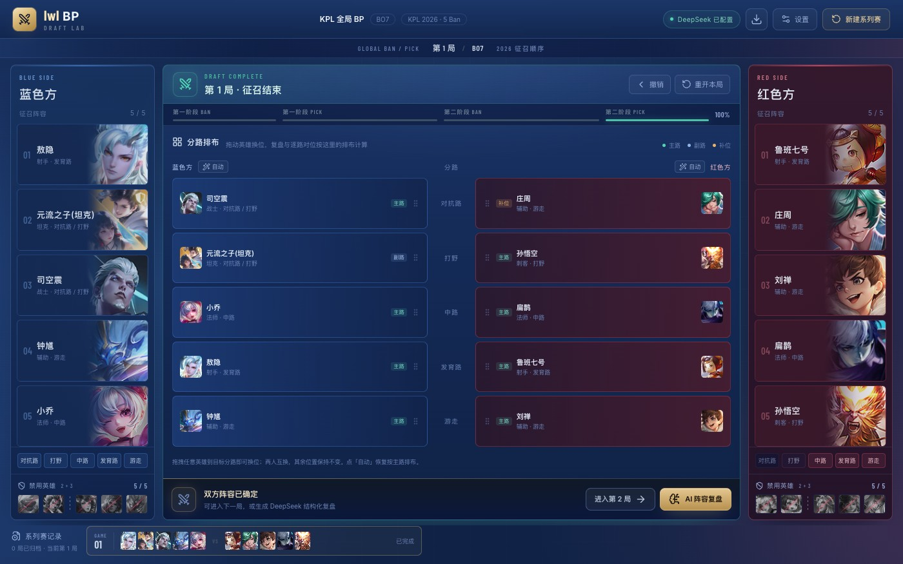
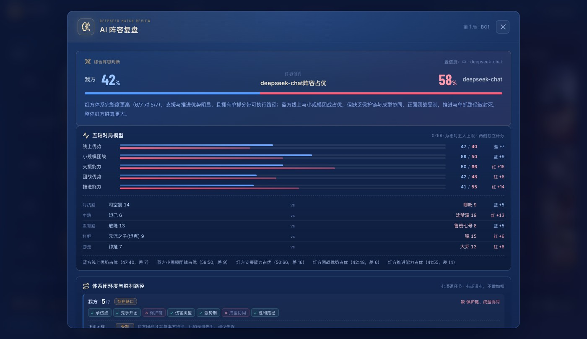

# wzry-bp · 王者荣耀 KPL 征召模拟器

在本地跑的 BP（Ban/Pick）模拟器：完整还原 KPL 全局 BP 的 20 手征召顺序，可以双人轮流操作，也可以让 AI 接管对面一方；BP 结束后生成阵容复盘——五轴对位、体系闭环度、胜利路径、版本强度都由代码先算，模型只负责解释。

BP 本身不联网、不需要密钥；只有「AI 阵容复盘」需要配置 DeepSeek API Key。

**功能一览**

- 两套规则：KPL 2026（每方 5 Ban，分段 2+3，一局 20 手）／经典征召（每方 4 Ban，2+2）
- 普通单局与 KPL 全局 BP（各队英雄池独立，用过的不能再选，Ban 不占池）；BO1/BO3/BO5/BO7，BO7 第七局自动切巅峰对决（无 Ban、秘密选人、同时揭晓）
- 双人对战／挑战 AI（执蓝执红可选，未配密钥时 AI 降级为本地规则引擎代打）
- BP 完成后五路整体最优排布（主路 100 / 副路 55 / 第三路 30 / 未列出 6），可拖拽换位，站错路标「补位」
- 复盘：组合协同、五轴、逐路对位、体系闭环度、胜利路径、版本强度全部代码先算；模型引用白名单外的事实编号会被标「未引用事实」
- 整轮系列赛记录可导出 JSON（记录只存页面内存，刷新即没）

---

## 快速开始

环境：Node **≥ 22.9**（启动脚本用 `--env-file-if-exists`，Node 20 会报 `bad option`）；桌面浏览器，建议 ≥ 1280px 宽。

```bash
git clone https://github.com/lwl-ManchesterCity/wzry-bp.git
cd wzry-bp
npm install
npm run dev
```

同时起两个进程：前端 Vite `http://127.0.0.1:5190`（端口写死在 `vite.config.ts`，被占用直接报错不顺延），服务端 Express `http://127.0.0.1:3001`（`/api/health`、`/api/ai-draft`、`/api/review`）。前端 `/api/*` 由 Vite 代理到 3001，**不要只开前端不开服务端**。

生产构建：`npm run build`（类型检查 + 打包到 `dist/`），`npm start` 只起服务端，`dist/` 需自行托管。

### 配置 DeepSeek 密钥（只用复盘才需要）

到 [platform.deepseek.com](https://platform.deepseek.com) 创建 API key（`sk-` 开头，只显示一次），然后：

```bash
cp .env.example .env
```

```ini
DEEPSEEK_API_KEY=sk-你的真实密钥
DEEPSEEK_BASE_URL=https://api.deepseek.com
DEEPSEEK_MODEL=deepseek-chat
PORT=3001
```

- `DEEPSEEK_API_KEY`：复盘必填；留空或 `sk-xxxxxx` 占位会被判为「未配置」
- `DEEPSEEK_BASE_URL` / `DEEPSEEK_MODEL`：官方直连不用改；用中转或别的模型时替换
- `PORT`：改它必须同步改 `vite.config.ts` 的 proxy 目标，否则前端调不到接口
- `.env` 已被 `.gitignore` 挡住，key 只在服务端读取，前端只拿得到「配没配好」这个布尔值
- **改完 `.env` 必须重启服务**，`--watch` 不会重读 env 文件

验证：`curl http://127.0.0.1:3001/api/health` 返回 `{"configured":true,...}`，或看界面左上角徽标显示「deepseek-chat 已配置」。

---

## 使用流程

### 第 1 步：开场页定对局



- **对战方式**：双人对战（共用设备轮流点）／挑战 AI（选中后多出「我的位置」：执蓝·先手有首抢权，执红·后手有后置针对性）
- **对局模式**：普通单局（每局池重置）／KPL 全局 BP（自己用过的自己不能再选，对方还能选；Ban 不进任何人的池）
- **赛制**：BO1/BO3/BO5/BO7；**征召规则**：KPL 2026（5 Ban，2+3）／经典（4 Ban，2+2）

底部灰字是配置实时摘要；点右下角**进入 BP 界面**。中途点 BP 页右上角「设置」可回本页，已有进度会弹确认框，确认后系列赛清空。

### 第 2 步：BP 界面操作



- **顶栏**：规则摘要 + 四个按钮（DeepSeek 徽标、导出 JSON、设置、新建系列赛）
- **阶段进度条**：四段高亮当前阶段，右上角整体百分比
- **中央英雄池**：按名/称号/编号搜索，职业与分路筛选；不可选自动置灰（被 Ban、被选、全局下自己已用）；**先点卡片预览、再点底部确认才算落子**
- **撤销 / 重开本局**：撤销回退上一手，人机模式整轮撤回到你上一手之前（否则 AI 同种子原样补回，撤销等于没撤）；重开只清当前小局
- **两侧阵容栏**：5 个 Pick 槽 + 禁用格（`2+3` 是 Ban 分段，`0/5` 是已用量）；分路标签高亮已覆盖的路，一眼看缺哪路
- **系列赛记录**：页底按小局列阵容与状态

KPL 2026 一局 20 手：

| 阶段 | 手数 | 谁在动 |
|---|---|---|
| 第一段 BAN | 4 | 蓝红交替，各 2 手 |
| 第一段 PICK | 6 | 蓝 1、红 2、蓝 2、红 1（首抢 → 连选 → 反手连选） |
| 第二段 BAN | 6 | 红蓝交替，各 3 手 |
| 第二阶段 PICK | 4 | 红 1、蓝 2、红 1 |

### 第 3 步：BP 完成 → 分路排布



双方各 5 手选完后阵容锁定，底部给出：**AI 阵容复盘**（下一步）、**进入第 N 局**（赛制打满则显示「系列赛已完成」；输赢不在这里判定）、**揭晓阵容**（仅 BO7 第七局未揭晓时）。记录刷新即没，留存请点顶栏下载图标导出 JSON。

中央区换成分路排布表：



- 五行：对抗路 / 打野 / 中路 / 发育路 / 游走；拖英雄到目标格或点选换位，占位格两人互换，也可从阵容栏直接拖入
- 每个英雄带主路 / 副路 / 补位标签；每侧「自动」一键回到主路最优排布
- 巅峰对决未揭晓时对手列显示「阵容待揭晓」
- 手动排布随复盘请求一起发送，逐路对位以你摆的为准

### 第 4 步：生成 AI 阵容复盘



点「AI 阵容复盘」，加载十几秒到几十秒后渲染报告，「重新分析」可同阵容再生成一次。前提：双方各 5 人选完、服务端配好 key、服务端在跑；缺哪条会直接提示。报告各块怎么读见下节。

---

## AI 对手怎么打

AI 接管对面每一手，不用等也不能替它选。**每场系列赛换一种执教思路**（六种按系列赛序号轮转，连开两场必不同，同一场 BO 内换局继续轮转）：

| 思路 | 想要什么 | 禁人时优先拆什么 |
|---|---|---|
| 版本答案 | 抢版本强度最高的 | 对手最可能一抢的强势点 |
| 强开团 | 先手开团、控制链连续 | 对手的保护与续航 |
| 保核心 | 保护链 + 后期大核 | 能越过前排切核心的英雄 |
| 运营推进 | 清线快、能压塔 | 对手清线快、能拖后期的 |
| 抓单切入 | 绕后机动 + 单点爆发 | 对手的高机动与保人 |
| 针对性 | 压制对手已选英雄 | 对手成型所需的那块拼图 |

思路显示在决策理由行右侧（`本局思路 · 强开团`），思考遮罩上也会写。它会看你的阵容临场调整权重（你双硬开团它抬抗控，你前排厚它偏持续输出），也会禁自己的软肋。

**先凑整队再落子**：每手用束搜索把剩下的人补齐成多套五路齐全的五人阵容，按前排、开团接火、保护、伤害类型、控制链、强势期、协同、对位给整队打分；禁人比较的是「对手拿到你」与「你被禁」两种最佳阵容的分差（理由如「禁后对手最佳整队评分下降 23.4」）。池不足 5 人凑不出整队时退回单英雄评分，不会卡住。

**候选池可摊开看**：落子后理由行右侧「候选依据 N」点开全部候选——按整队评分排序，AI 选中的带金色徽章；选人附「凑成：…」五人名单，禁人附「禁后对手整队 −31.5」；顶部总结「共 8 个候选 · AI 选中第 2，比最高分低 7」，同分写「与另外 N 个同分」，同一套阵容只第一行打全名单。用它分清问题在模型没按评分走、还是评分权重本身要调。

它还记得本场系列赛：前几局用过的英雄压低权重，同一场 BO 不摆一模一样的五人。未配 key 时规则引擎代打，思路轮转与整队规划照旧，只是理由文案非模型所写。打分在 `server/ai-draft.mjs` 与 `server/team-planner.mjs`，思路权重在 `shared/styles.mjs`，改完重启服务生效。

---

## 复盘面板怎么读

**②–⑥ 是代码算的硬结论，① 和 ⑦–⑨ 是模型基于它们写的解释**；① 的百分比由模型给（程序只保证两边相加 100），要看它是否跟着事实走。

- **① 综合阵容判断**：双方胜率 + 谁占优 + 模型与置信度。是阵容层面的相对倾向，不是对局预测
- **② 五轴对局模型**：线上 / 小规模团战 / 支援 / 团战 / 推进，0–100 为「相对五人上限的完成度」、两侧独立计分；差值 <6 显示「接近」。逐路对位表三种特殊值：`无人`（本方这路没人）、`无对位`（对面空缺）、`补位`（非该路常规选择）
- **③ 体系闭环度与胜利路径**：团战拆七项硬环节——承伤（前排 ≥6/15）、先手开团（硬开团 ≥1）、保护链（保人 ≥1）、伤害类型（≥2 类且最大类 ≤3）、强势期（同期 ≥3）、成型协同（组合库命中 ≥1）、胜利路径（至少一条没被封死）——逐项判有无、**不加权求和**；按缺几项分档 7/7 S → 更低 C，chip 悬停看数值与原因。胜利路径三条（正面团战 / 推进拆塔 / 单抓分带）各判 `可执行 / 受制 / 被封死`，先判自己够不够格、再判对方解不解得掉。**双方差 ≥2 环节触发「体系优先」**：落后方的对线优势只写「局部领先」，不能据此判整体占优
- **④ 版本强度**：出场 × 胜率合成 0–100，分 T0(≥80)/T1(≥65)/T2(≥50)/T3；公式 `25 + 50×min(1, 出场÷赛季最高) + 25×clamp((胜率−45)÷20, 0, 1)`。**未登场记「无样本」不给低分**，团队均分只用有效样本。体系差 ≥2 环节时标「本轮仅作诊断」，只进强弱项、不改判定
- **⑤ 组合协同与结构**：强协同 / 条件协同（「机制推导」= 按技能模板推出、组合库没写死）、被 Ban 拆断的组合；结构指标（前排满分 15、硬开团、保人、消耗、控制、机动）+ 按严重度排序的结构问题
- **⑥ 分析依据**：赛季区间与数据截至时间、各英雄出场与胜率；虚线框 = 样本不足 15 场
- **⑦ 双方阵容分析 / ⑧ 关键对位与联动 / ⑨ 本场获胜条件**（模型）：优势短板节奏打法、重点对位、编号获胜条件。⑧ 标题带「未引用事实」= 该结论没对应到任何事实块，属模型自由发挥，可信度打折

阈值标定与算法分工见 `docs/HANDOFF.md` 第 3–4 节。面板底部有免责说明：结论仅供阵容讨论。

---

## 常见问题

**Q：左上角一直「待配置」**
`.env` 不在根目录（须与 `package.json` 同级）、改完没重启、key 是占位值，三者之一。`curl http://127.0.0.1:3001/api/health` 最直接。

**Q：复盘报 401 / invalid api key**
key 带空格换行或已删除/额度用尽。重建一把，粘贴不带引号空格，重启。

**Q：复盘一直转圈然后报错**
看服务端终端报错：多为到 `api.deepseek.com` 网络不通（换 `DEEPSEEK_BASE_URL` 中转）或模型名与账号可用模型不符。

**Q：AI 等很久或落了个莫名其妙的英雄**
单步 30 秒超时后兜底落子并提示「AI 决策超时」。频繁出现查网络或服务端日志。

**Q：候选依据里 AI 选中的不是最高分**
正常。模型在整队评分上叠加思路、临场针对与同分打散；差得小是同档内挑，差 20 分以上才值得怀疑没按评分走。

**Q：蓝方线上被压却判蓝方占优**
看闭环度通过环节数：差 ≥2 触发体系优先，对线优势抵不掉缺开团/缺保护/伤害单一。不认同判准改 `server/composition.mjs` 阈值或 `server/index.mjs` 的 prompt 约束。

**Q：3001 被占用**
改 `.env` 的 `PORT` 并同步改 `vite.config.ts` proxy 目标，重启。

**Q：改了 hero-synergy.json 界面没变化**
服务端组合检测启动时读文件，要重启服务端。

**Q：刷新页面系列赛没了**
记录是内存态，无持久化。留存点顶栏下载导出 JSON（`kpl-draft-<时间戳>.json`）。

**Q：BO7 第七局为什么没有 Ban 位**
巅峰对决规则即无 Ban，秘密选完再揭晓。

**Q：某一路显示「无人」**
阵容里没人主路是这条路且你没手动拖人过去；手动排布后即显示对位。

---

## 开发与测试

| 命令 | 说明 |
|---|---|
| `npm run dev` | 前端 + 服务端一起起 |
| `npm run build` | `vue-tsc` 类型检查 + Vite 打包 |
| `npm test` | Vitest 单测，118 项（含整队规划、Ban 损失、闭环度、版本强度、候选视图） |
| `npm run test:ui` | 端到端：跑完 20 手 BP 并触发真实复盘（需要 key） |
| `npm run test:ai` | 人机对战闭环 |
| `npm run test:lineup` | 分路面板：点击换位、拖拽换位、自动复位 |
| `npm run test:ai-variety` | AI 差异性：同玩家阵容换 8 个种子，禁选与阵容是否分散且五路齐全 |
| `npm run test:ai-style` | AI 差异性端到端：连开两场看思路轮转与禁选变化 |
| `npm run heroes:fetch` | 重新抓取英雄与头像 |
| `npm run stats:fetch` | 更新 KPL 赛季数据快照 |

冒烟脚本用本机 Chrome，路径写死在 `scripts/*.mjs`，换机器要改或换 `channel: 'chrome'`。

```
src/
  engine/        BP 顺位状态机 draft.ts、分路求解 lineup.ts
  components/    SetupScreen / TeamPanel / HeroPool / LineupBoard / ReviewModal / AppSelect
  composables/   useDraft：一局完整状态、AI 回合接管、导出
  data/          heroes.json 133 英雄｜hero-synergy.json 10 维标签+43 条组合
                 hero-macro.json 宏观七维(0–3)｜kpl-stats.json 赛季快照
shared/          lanes.mjs 前后端共用落位算法、styles.mjs AI 思路权重表
server/          index.mjs 入口+prompt+事实校验、synergy 组合、matchup 五轴
                 composition 闭环度+胜利路径、meta-strength 版本强度
                 ai-draft 决策、team-planner 整队推演、candidate-view 候选池视图
tests/           Vitest 单测
scripts/         数据抓取与端到端冒烟
docs/            HANDOFF.md 交接文档、界面截图
```

算法分工、阈值标定依据、factKey 白名单机制与踩坑记录见 `docs/HANDOFF.md`。

---

## 已知限制

- 组合库与宏观七维是按英雄机制人工标注，非官方数据，理解不同改 JSON 即可
- 赛季数据是快照，手动 `stats:fetch` 才更新；出场不足 15 场参考价值有限，未登场记「无样本」而非弱
- 闭环度与胜利路径阈值按 133 英雄随机抽 5 人的分布分位定，非官方标准；改前必须重新看分布
- 复盘胜率百分比由模型给出，具体比数（如「七三开」）无标定依据，不承诺对齐
- 五轴是相对量，适合横向比阵容，不适合跨对局纵向比
- 对位只按主路落位，副路不自动补位，跨路需手动拖
- AI 是程序化权重，不是真战术板推演，不会职业队式针对性设套
- 记录不持久化（仅思路轮转序号存 localStorage）；移动端未适配

---

## 免责声明

本项目仅用于学习与技术演示。英雄名称、头像及相关数据版权归腾讯《王者荣耀》所有；开发过程中未使用任何商业素材分发。AI 复盘结论由大模型生成，仅供参考。